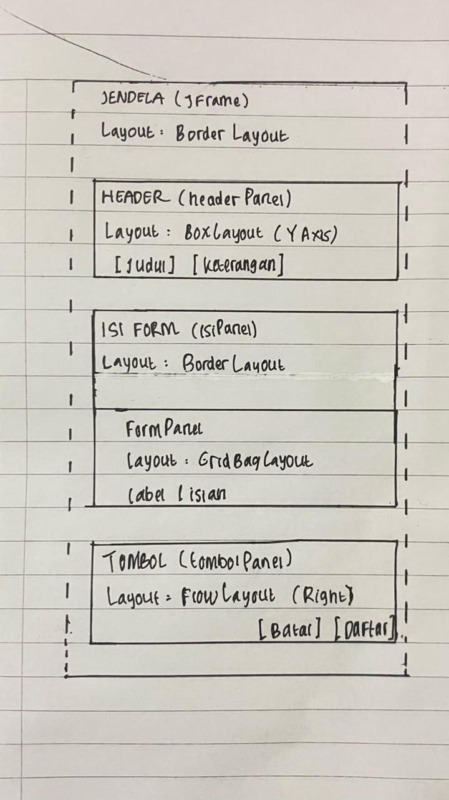
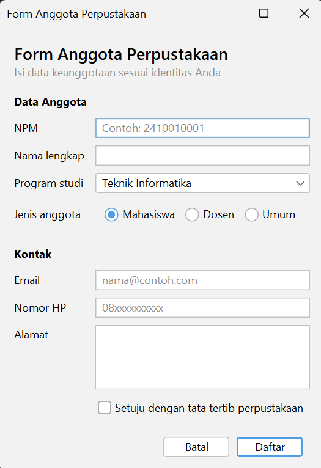
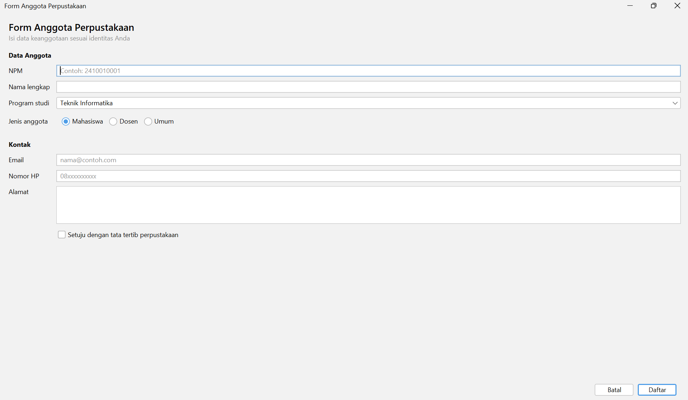
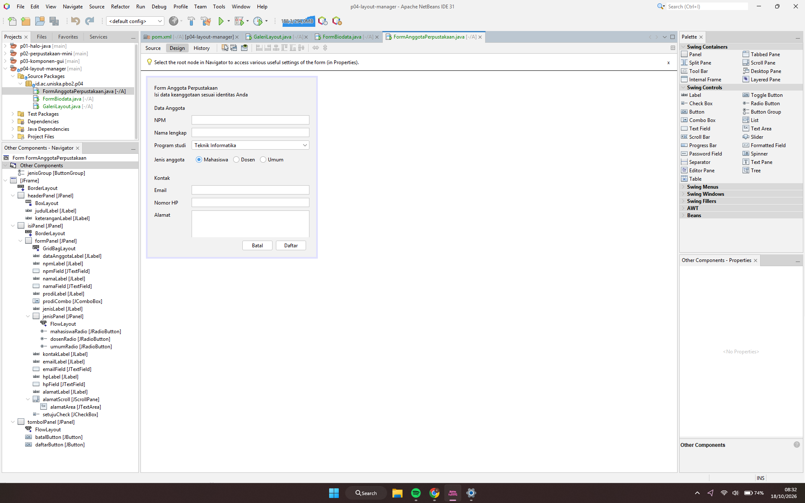

# P04 - Layout Manager dan Desain Form

Nama: Ariefa Salsabilla Azzahra
NPM: 2410010519

## Tabel Rancangan

| Bagian | Panel | Layout |
|---|---|---|
| Jendela | JFrame | BorderLayout |
| Header | headerPanel | BoxLayout (Y Axis) |
| Isi form | isiPanel (+ formPanel) | BorderLayout; formPanel GridBagLayout |
| Tombol | tombolPanel | FlowLayout (Right) |

Sketsa: 

## Tangkapan Layar

Ukuran awal: 

Dilebarkan: 

Tab Design + Navigator: 

## Eksperimen Praktikum 2

1. Setelah Alignment pada flowPanel diubah dari Left menjadi Center, tombol-tombol berkumpul di tengah panel. Ketika jendela dikecilkan, tombol "Keluar" berpindah ke baris kedua dan tetap berada di tengah, sedangkan ukuran tombol tidak berubah. Baris di initComponents() yang ikut berubah adalah `flowPanel.setLayout(new java.awt.FlowLayout(java.awt.FlowLayout.CENTER, 8, 8));`, yang sebelumnya bernilai `FlowLayout.LEFT`.

2. Terbentuk 5 baris. Ketika Rows bernilai 0, jumlah baris dihitung otomatis dari banyaknya komponen dan jumlah kolom. Terdapat 9 tombol dan 2 kolom, sehingga 9 / 2 = 4,5 dan dibulatkan ke atas menjadi 5 baris. Baris terakhir hanya berisi tombol 9.

3. Setelah maximumSize keempat tombol diisi lebar 32767 dan tinggi 23 (sama dengan tinggi tombol), semua tombol melebar memenuhi lebar panel sehingga memiliki lebar yang sama. Sebelumnya, lebar tombol mengikuti panjang teksnya. Setelah Vertical Strut ditambahkan di antara tombol, muncul jarak kosong yang tetap di antara tombol-tombol tersebut.

## Eksperimen Praktikum 4

1. Setelah Weight X namaField diubah menjadi 0.0 dan jendela dilebarkan, isian Nama lengkap tetap ikut melebar bersama isian lainnya. Hal ini terjadi karena pembagian lebar tambahan dilakukan per kolom, dan bobot kolom ditentukan oleh komponen dengan bobot terbesar di kolom tersebut (isian lain masih 1.0). Selain itu, Fill Horizontal membuat namaField tetap memenuhi lebar selnya.

2. Setelah Direction formPanel diubah dari North menjadi Center dan jendela ditinggikan, baris-baris form tidak lagi menempel di bawah header, melainkan bergeser ke tengah dengan ruang kosong di atas dan di bawahnya. Pada pengaturan semula (North), baris form selalu menempel tepat di bawah header.

3. Setelah baris setMinimumSize(getSize()) dihapus dan jendela dikecilkan sekecil mungkin, bagian yang rusak lebih dulu adalah isian (Text Field, Combo Box, Spinner, dan Text Area). Isian menyusut mengikuti lebar jendela sampai tidak terlihat sama sekali, sehingga yang tersisa hanya label-labelnya. Setelah itu judul dan keterangan di header ikut terpotong (menjadi "Biodata ..." dan "Lengkapi data ..."), tombol Batal dan Simpan bertumpuk ke bawah dengan tombol Simpan terpotong, dan bagian Kontak serta Alamat tidak terlihat lagi. Dengan setMinimumSize(getSize()), jendela tidak bisa dikecilkan melebihi ukuran awalnya, sehingga semua komponen tetap terlihat utuh.

## Saran Teman (Tahap 4)

Nama teman: Dhea Novita Amelia Putri

Hasil pemeriksaan 8 butir: Ya untuk semua butir (1 sampai 8).

Saran: Saran saya, di bagian labelFor bisa kamu isi dengan isian pasangannya masing-masing, misalnya npmLabel ke npmField, supaya label dikenali pembaca layar. Sesuai dengan panduan pada Form Biodata sebelumnya.

Tindak lanjut: Saran sudah diterapkan, labelFor pada setiap label sudah diisi dengan isian pasangannya.

## Jawaban Refleksi

1. Null Layout dan Absolute Layout memakai posisi piksel tetap sehingga tampilan tidak menyesuaikan ukuran jendela dan teks dapat terpotong pada skala layar berbeda. Absolute Layout juga butuh library tambahan NetBeans sehingga sulit dijalankan di komputer lain.

2. FlowLayout menjaga ukuran asli komponen dan hanya menggeser atau memindah baris. GridLayout membagi ruang jadi sel sama besar sehingga semua komponen ikut melebar saat jendela dilebarkan.

3. Weight X membagi sisa lebar antar kolom (isian 1.0, label 0.0). Fill menentukan komponen memenuhi sel (Horizontal agar isian ikut melebar). Keduanya membuat label tetap dan isian melebar.

4. formPanel dibungkus isiPanel (BorderLayout) dan diletakkan di North agar baris form tetap di atas dan tidak meregang saat jendela ditinggikan.

5. Dua prinsip desain yang diterapkan pada FormAnggotaPerpustakaan:
(a) Keselarasan. Semua label berada di kolom pertama (Grid X 0, Anchor West) dan semua isian di kolom kedua (Grid X 1, Fill Horizontal), sehingga label dan isian membentuk garis lurus dari NPM sampai Alamat. Buktinya terlihat pada anggota-awal.png: tepi kiri semua label sejajar dan tepi kiri semua kotak isian juga sejajar. Pada anggota-lebar.png, isian ikut melebar (Weight X 1.0) sedangkan label tetap pada posisinya (Weight X 0.0), sehingga susunan tetap rapi.

(b) Kedekatan. Isian yang sejenis dikelompokkan di bawah judul bagian "Data Anggota" dan "Kontak". Judul bagian ditampilkan dengan huruf tebal (styleClass h4), dan sebelum judul "Kontak" diberi jarak atas 16 piksel (Insets atas 16). Buktinya terlihat pada anggota-awal.png: terdapat celah yang jelas antara kelompok Data Anggota dan kelompok Kontak, sedangkan isian dalam satu kelompok saling berdekatan. Susunan baris dan layout juga terlihat pada anggota-navigator.png (formPanel dengan GridBagLayout).

## Deklarasi Penggunaan AI

Saya menggunakan Claude (Anthropic) untuk: (1) memandu langkah penggunaan NetBeans GUI Builder, termasuk mencari penyebab kesalahan saat menyusun panel dan layout, (2) membantu merumuskan draf jawaban eksperimen, dan (3) membantu menyusun README. Jawaban eksperimen saya cocokkan dengan hasil percobaan dan tangkapan layar saya sendiri. (4) membantu menyusun refleksi nomor 5
