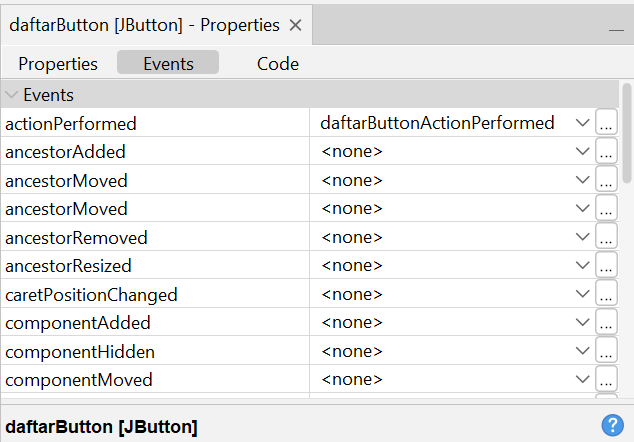
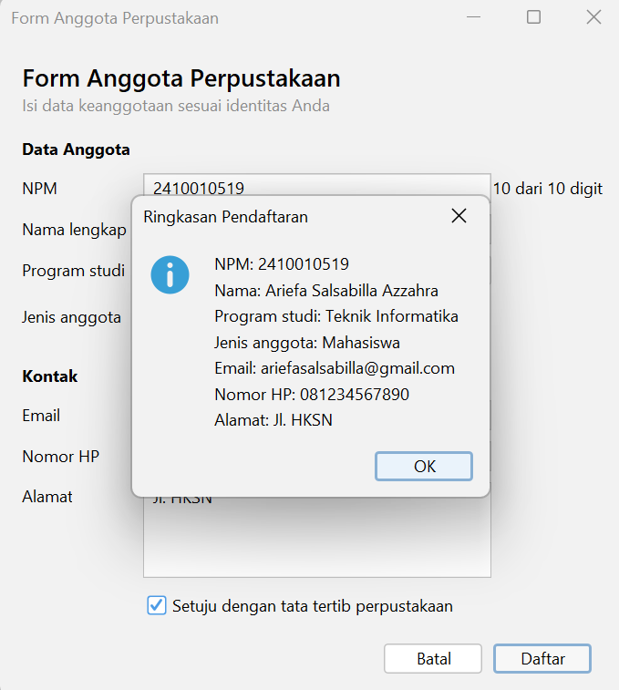
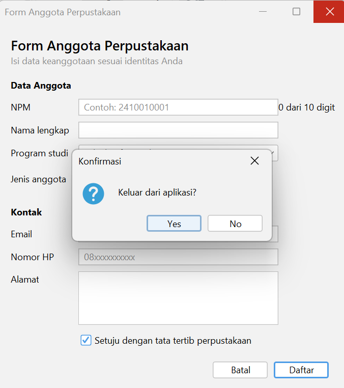

# P05 Event Handling

Nama: Ariefa Salsabilla Azzahra
NPM: 2410010519
Kelas: 5B TI Reg Bjm
Mata kuliah: Pemrograman Berbasis Objek 2

Proyek ini berisi empat form Java Swing yang dibuat dengan GUI Builder NetBeans: PengamatEvent, KonversiSuhu, KalkulatorSederhana, dan FormAnggotaPerpustakaan. Kelas KonverterSuhu menyimpan logika konversi suhu secara terpisah dari tampilan.

## Praktikum 2: Tabel Pengamatan

| No | Tindakan | Event yang tercatat |
|----|----------|---------------------|
| 1 | Arahkan kursor ke tombol, lalu jauhkan | MouseEvent (mouseEntered), MouseEvent (mouseExited) |
| 2 | Klik tombol Klik saya | MouseEvent (mouseEntered), ActionEvent (actionPerformed), MouseEvent (mouseExited) |
| 3 | Centang lalu hapus centang Aktifkan fitur | ItemEvent "kotak dicentang", ItemEvent "centang dihapus" |
| 4 | Ganti pilihan dari Pagi menjadi Malam | ItemEvent "memilih Malam" (tercatat sekali karena DESELECTED difilter) |
| 5 | Klik isian, lalu ketik kata "abc" | FocusEvent (focusGained), KeyEvent (keyTyped) untuk huruf a, b, dan c |
| 6 | Klik tombol setelah mengetik di isian | MouseEvent (mouseEntered), FocusEvent (focusLost), ActionEvent (actionPerformed), MouseEvent (mouseExited) |

Catatan: WindowEvent (windowOpened) tercatat satu kali di awal saat jendela dibuka.

## Praktikum 3: Jawaban Eksperimen Konversi Suhu

Eksperimen 1. Pesan "item berubah" tercetak 2 kali setiap pilihan combo diganti. Satu kali untuk pilihan lama (DESELECTED) dan satu kali untuk pilihan baru (SELECTED). Karena itu itemStateChanged perlu memeriksa ItemEvent.SELECTED supaya konversi hanya berjalan sekali.

Eksperimen 2. Hasil terlambat satu karakter karena saat keyPressed terpicu, karakter yang baru diketik belum masuk ke isian, sehingga getText() masih membaca teks sebelumnya. Pada keyReleased karakter sudah masuk, jadi hasilnya sesuai.

Eksperimen 3. Tanpa try dan catch, mengetik huruf di isian memunculkan error di jendela Output: Exception in thread "AWT-EventQueue-0" java.lang.NumberFormatException: For input string: "abc". Pengguna tidak melihat pesan apa pun di form.

## Praktikum 4: Jawaban Eksperimen Kalkulator Sederhana

Eksperimen 1. Pesan "kali" tercetak 2 kali setiap tombol x diklik. Tombol itu punya dua listener: satu dari event handler GUI Builder dan satu dari lambda di konstruktor, dan keduanya berjalan. Satu tombol sebaiknya memakai satu cara saja agar aksinya tidak berjalan dua kali.

Eksperimen 2. Menambahkan tombol % untuk sisa bagi:
- Tab Design: tambah satu Button bernama modulusButton dengan text %, ubah Columns pada GridLayout operatorPanel dari 4 menjadi 5, lalu buat event actionPerformed lewat Events.
- Tab Source: isi method modulusButtonActionPerformed dengan hitung('%'), tambah case '%' -> a % b; pada switch di method hitung, dan tambahkan operator == '%' pada pengecekan pembagi nol.

Eksperimen 3. Kursor langsung berada di isian pertama karena method hapus memanggil angka1Field.requestFocusInWindow() di baris terakhir. Perintah itu memindahkan fokus keyboard ke angka1Field, sehingga pengguna bisa langsung mengetik angka baru tanpa mengklik isian lagi.

## Latihan Mandiri: FormAnggotaPerpustakaan

### Peta Event

| Komponen | Menu Events | Aksi |
|----------|-------------|------|
| Kotak centang setuju (setujuCheck) | Item: itemStateChanged | Tombol Daftar hanya aktif jika dicentang |
| Tombol Batal (batalButton) | Action: actionPerformed | Kosongkan semua isian dan kembalikan fokus ke NPM |
| Tombol Daftar (daftarButton) | Action: actionPerformed | Tampilkan ringkasan data dengan JOptionPane |
| Isian NPM (npmField) | Key: keyReleased | Label kecil (digitLabel) menampilkan jumlah digit, misalnya "8 dari 10 digit" |
| Form (JFrame di Navigator) | Window: windowClosing | Minta konfirmasi sebelum aplikasi ditutup |

Pengaturan properti: defaultCloseOperation form diubah menjadi DO_NOTHING dan centang enabled pada tombol Daftar dihilangkan.

Logika yang sama ditulis dalam satu method dan dipanggil dari beberapa event handler pada KonversiSuhu dan KalkulatorSederhana (method konversi dan hitung).

### Tangkapan Layar

Properties bagian Events untuk tombol Daftar:

Dialog ringkasan:

Dialog konfirmasi keluar:

## Deklarasi Penggunaan AI

Saya menggunakan Claude (Anthropic) untuk memandu langkah pengerjaan tugas ini dan untuk menyusun README. Kode diketik dan dijalankan sendiri di NetBeans, dan semua hasil pengamatan serta tangkapan layar berasal dari percobaan saya.