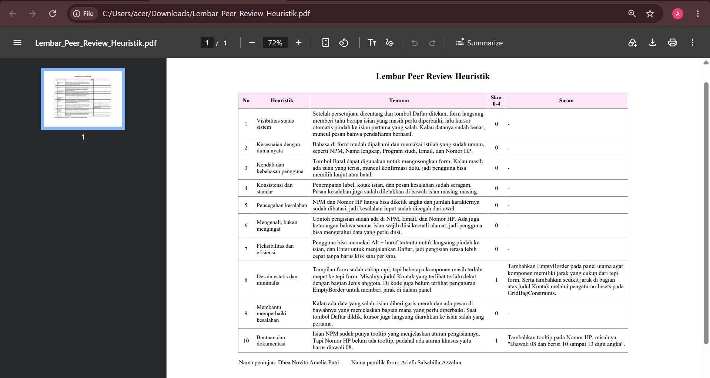
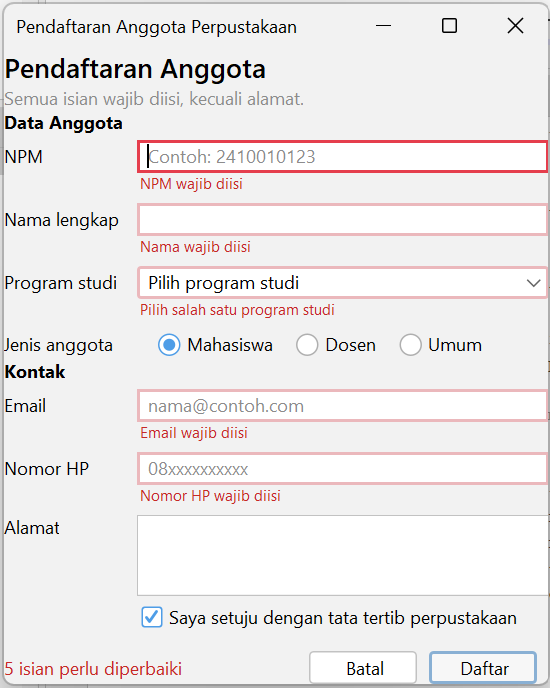
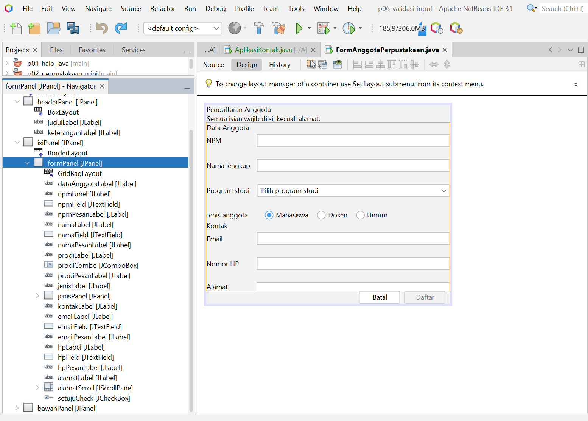

# Tugas 6 - Validasi Input dan Kegunaan

Mata kuliah: Pemrograman Berbasis Objek 2 (TIF1508), Pertemuan 6

Nama: Ariefa Salsabilla Azzahra
NPM: 2410010519
Kelas: 5B TI Reg Bjm

Proyek: `p06-validasi-input` (package `id.ac.uniska.pbo2.p06`)

File form yang dikumpulkan: `FormAnggotaPerpustakaan.java` dan `FormAnggotaPerpustakaan.form`. Saat Praktikum 3 form ini bernama `FormAnggota` sesuai modul, lalu namanya diganti menjadi `FormAnggotaPerpustakaan` lewat Refactor di NetBeans sesuai ketentuan pengumpulan.

File lain di proyek:
- `Validator.java`: aturan validasi NPM, nama, email, dan nomor HP.
- `UjiValidator.java`: pengujian aturan Validator tanpa GUI.
- `P06ValidasiInput.java`: kelas bawaan NetBeans saat proyek dibuat.

## 1. Lembar Peer Review

Teman peninjau: Dhea Novita Amelia Putri

Dhea menilai delapan dari sepuluh heuristik dengan skor 0 (tidak ada masalah). Dua heuristik mendapat skor 1 (kosmetik), yaitu heuristik 8 (desain estetis dan minimalis) dan heuristik 10 (bantuan dan dokumentasi).

## 2. Temuan Teman, Perbaikan, dan Commit

| No | Temuan dari teman | Skor | Perbaikan yang saya lakukan | Commit |
|----|-------------------|------|-----------------------------|--------|
| 1  | Heuristik 8: komponen terlalu mepet ke tepi form, dan judul Kontak terlalu dekat dengan baris Jenis anggota. | 1 | Menambah jarak 12 piksel di seluruh tepi form dengan `EmptyBorder` pada content pane, dan mengubah Insets bagian atas `kontakLabel` menjadi 12. | `484f7fe` |
| 2  | Heuristik 10: isian Nomor HP belum punya tooltip, padahal ada aturan khusus (diawali 08). | 1 | Menambah `toolTipText` pada `hpField`: "Diawali 08 dan berisi 10 sampai 13 digit angka". | `484f7fe` |

Kedua perbaikan ada dalam satu commit khusus perbaikan peer review: `484f7fe` ("P06: perbaikan hasil peer review (jarak tampilan dan tooltip nomor HP)").

## 3. Tangkapan Layar

Form dengan pesan kesalahan (garis merah, pesan di bawah isian, dan ringkasan jumlah kesalahan):

Jendela Navigator yang memperlihatkan label pesan (`npmPesanLabel`, `namaPesanLabel`, `prodiPesanLabel`, `emailPesanLabel`, `hpPesanLabel`):

## 4. Jawaban Eksperimen Praktikum 4

1. Mengetik huruf pada isian NPM: huruf tidak masuk, dan angka berhenti di 10 digit. Penyebabnya baris `evt.consume()` di dalam `npmFieldKeyTyped`, yang berjalan kalau karakter bukan angka atau isian sudah 10 digit.
2. Email diisi `siti@` lalu Tab: pesan "Format email belum benar, contoh: nama@contoh.com" muncul saat fokus meninggalkan isian, lewat event `focusLost`.
3. Klik isian Nama tanpa mengetik lalu Tab: tidak ada pesan kesalahan. `namaFieldFocusLost` hanya memeriksa isian yang tidak kosong, jadi isian kosong baru diperiksa saat tombol Daftar diklik.
4. Centang persetujuan lalu klik Daftar dengan form kosong: fokus pindah ke NPM (kesalahan pertama). Muncul lima pesan "wajib diisi" dan ringkasan "5 isian perlu diperbaiki".
5. Alt + N: fokus pindah ke isian Nama lengkap. Yang mengaturnya properti `displayedMnemonic` (N) dan `labelFor` pada `namaLabel`.
6. Isi beberapa isian, klik Batal, lalu pilih No: data tetap ada, karena method `batal()` berhenti (`return`) kalau jawabannya bukan Yes.

## 5. Deklarasi Penggunaan AI

Saya memakai Claude untuk panduan langkah pengerjaan di NetBeans, penjelasan kode, dan pengecekan kode yang saya kirim. Kode akhir saya ketik dan uji sendiri.
